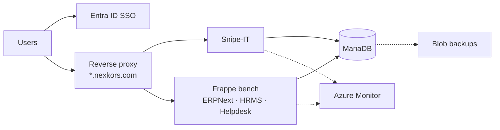

# CloudOps Business Platform

A secure, modular, cloud-hosted business operations environment for small and medium-sized
organizations, built on Microsoft Azure. It brings identity, HR, IT asset management, ERP,
helpdesk, monitoring, automation and backup together into one digital workplace.

**One platform. Multiple business operations. Centralized control.**

This repository is both the engineering workspace and the portfolio record. It distinguishes
what is implemented and tested from what is still a design target.

## Architecture



Full diagram: [architecture/diagrams/logical-architecture.md](architecture/diagrams/logical-architecture.md)

## Modules

| Module | Product | Planned URL |
| --- | --- | --- |
| Identity and access | Microsoft Entra ID | |
| IT asset management | Snipe-IT | `assets.nexkors.com` |
| Human resources | Frappe HRMS | `hr.nexkors.com` |
| ERP | ERPNext | `erp.nexkors.com` |
| IT service management | Frappe Helpdesk (candidate, ADR-008) | `help.nexkors.com` |
| Productivity | Microsoft 365 | |

## Project status

Status values follow the blueprint: Not started, In progress, Completed, Validated, Documented.
Creating a resource is not the same as completing a capability.

| Phase | Scope | Status |
| --- | --- | --- |
| 0 | Product definition and solution design | In progress |
| 1 | Azure foundation (network, IAM, hardening, budgets) | In progress |
| 2 | Linux and container platform | Not started |
| 3 | Business applications | Not started |
| 4 | Microsoft 365 and Entra ID integration | Not started |
| 5 | DevOps and CI/CD | Not started |
| 6 | Infrastructure as Code (adopted early, ADR-005) | Not started |
| 7 | Monitoring and observability | Not started |
| 8 | Backup and disaster recovery | Not started |
| 9 | Multi-tenant SaaS architecture | Not started |
| 10 | Production readiness and portfolio | Not started |

### What exists today

- Azure VNet `vnet-cloudops-dev-weu-01` (`10.0.0.0/16`, West Europe). Subnet prefixes are
  [pending reconciliation](architecture/networking/subnet-plan.md).
- Entra ID groups: CloudOps-Admins, CloudOps-IT, CloudOps-HR, CloudOps-Users.
- Resource group `snipeit-rg`.

## Repository layout

Directories are added as phases begin.

```
architecture/
  decisions/      Architecture Decision Records (ADR-001 to ADR-009)
  diagrams/       Logical and physical diagrams (Mermaid)
  networking/     Subnet plan, NSG matrix
documentation/
  product/        Vision, requirements
```

## Key decisions

See [architecture/decisions](architecture/decisions/README.md). Highlights:

- Docker Compose on a single VM before Kubernetes (ADR-001, ADR-007).
- Terraform adopted from Phase 1 rather than Phase 6 (ADR-005).
- Caddy reverse proxy before Application Gateway to control cost (ADR-009).

## Documentation standard

Every significant implementation records what was implemented, why, how it works, dependencies,
security controls, verification, troubleshooting, recovery, and lessons learned.

## License

[MIT](LICENSE)
