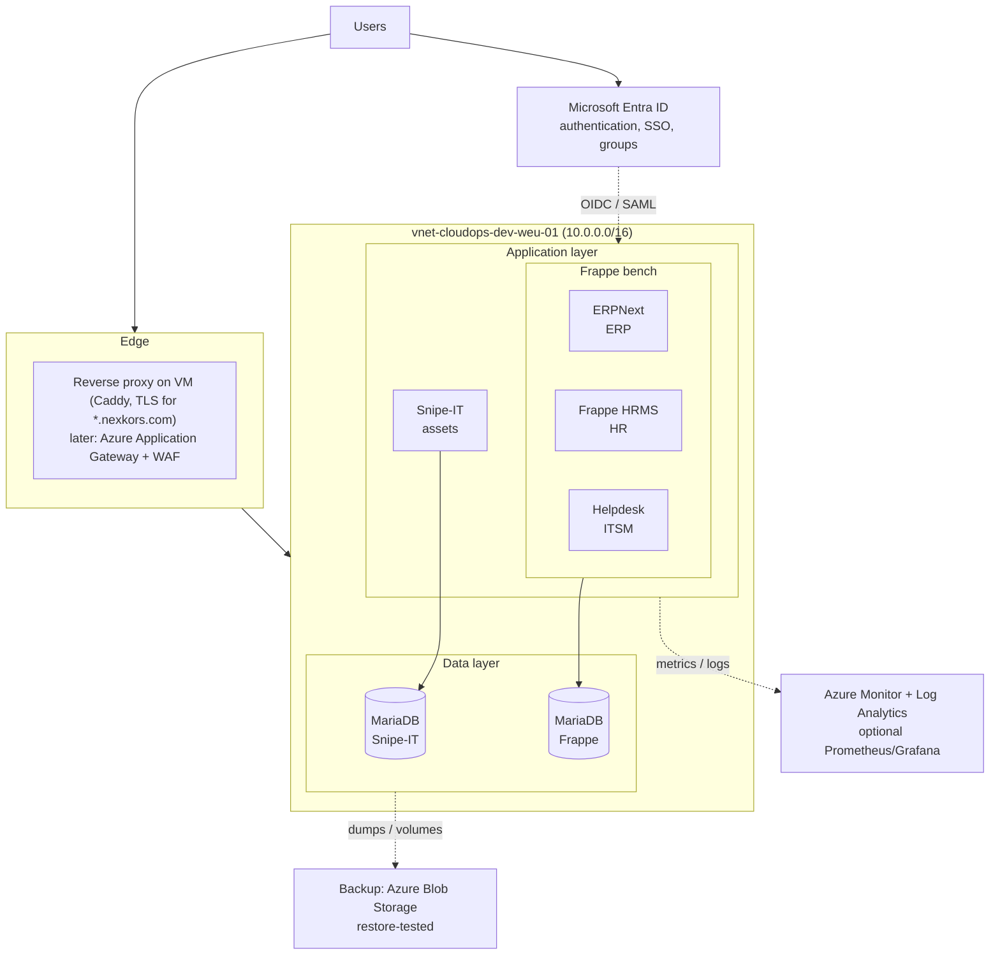

# Logical Architecture

Status: **Design target.** Nothing below the Entra ID layer is deployed yet; see the
status table in the [README](../../README.md).

## Request path and layers

## Layer summary

| Layer | Components | Phase |
| --- | --- | --- |
| Identity | Entra ID, CloudOps-* groups, app registrations | 1, 4 |
| Edge | Caddy on VM now; Application Gateway + WAF as a later, time-boxed extension (ADR-006, ADR-009) | 2, 10 |
| Network | VNet, subnets, NSGs (see [subnet plan](../networking/subnet-plan.md)) | 1 |
| Application | Docker Compose on one Ubuntu VM (ADR-001, ADR-007) | 2, 3 |
| Data | MariaDB containers with private networks only | 3 |
| Monitoring | Azure Monitor Agent, Log Analytics, alerts | 7 (baseline in 2) |
| Backup | DB dumps and volume archives to Blob, restore tests | 8 (baseline in 2) |

The original ASCII sketches (August 2026) are kept in Git history.
